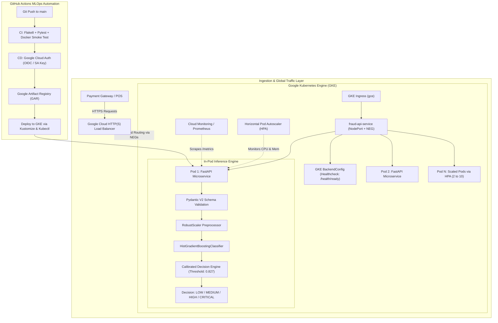

# 🛡️ Real-Time Transaction Fraud Detection Platform
### Production MLOps Microservice with FastAPI, Gradient Boosting, Docker, GitHub Actions CI/CD & Google Cloud Platform (GKE + Artifact Registry)

[](https://github.com/SAINIKHIL2902/mlops-fraud-detection-gke/actions/workflows/ci.yml)
[](https://fastapi.tiangolo.com)
[](https://www.python.org/)
[](https://www.docker.com/)
[](https://cloud.google.com/kubernetes-engine)
[](https://cloud.google.com/artifact-registry)
[](https://prometheus.io/)

---

## 📌 Executive Summary

This repository contains an end-to-end, production-grade MLOps platform addressing one of the most critical real-time ML challenges in modern fintech: **Real-Time Financial Transaction Fraud Detection**.

High-throughput payment networks (Stripe, Visa, Adyen, Banking APIs) demand sub-20ms inference latency to score and approve card transactions before payment authorization. This solution delivers:
1. **Low-Latency ML Pipeline**: Pre-calibrated Gradient Boosting (`HistGradientBoostingClassifier` + `RobustScaler`) delivering **sub-10ms** inference latency, high PR-AUC (~0.99), and threshold calibration that penalizes costly false negatives.
2. **FastAPI Serving Microservice**: High-throughput asynchronous REST API featuring Pydantic V2 schema validations, batch inference, Kubernetes liveness/readiness probes, and native **Prometheus exposition metrics** (`/metrics`).
3. **Enterprise Containerization**: Secure multi-stage Docker build running under a non-root user (`appuser:1001`), with built-in zero-dependency health checks.
4. **Automated CI/CD (GitHub Actions)**:
   - **Continuous Integration (CI)**: Code linting (Flake8), automated unit/integration tests with Pytest, Docker image build, and container smoke testing.
   - **Continuous Deployment (CD)**: Automated image build, dual tagging (`git-sha` + `latest`), push to **Google Artifact Registry (GAR)**, automated GKE credentials setup, and rolling zero-downtime deployment to **Google Kubernetes Engine (GKE)** via **Kustomize**.
5. **Production Kubernetes Architecture on GCP (GKE)**:
   - Isolated `mlops-fraud` namespace
   - GKE Container-Native Load Balancing via **Network Endpoint Groups (NEG)**
   - GKE **`BackendConfig` CRD** for Cloud Load Balancer health checking (`/health/ready`) and connection draining
   - GKE Ingress (`gce`) backed by Google Cloud Global HTTP(S) Load Balancing
   - Horizontal Pod Autoscaler (HPA) scaling between 2 to 10 pods based on CPU and memory thresholds

---

## 🏗️ System Architecture on Google Cloud Platform



---

## 📁 Repository Structure

```text
mlops-fraud-detection-gke/
├── .github/
│   └── workflows/
│       ├── ci.yml                 # Linting, Pytest, Docker build & local verification
│       └── cd.yml                 # Google Artifact Registry push & GKE Continuous Deployment
├── app/
│   ├── __init__.py
│   ├── main.py                    # FastAPI entrypoint, lifespan, CORS, and timing middleware
│   ├── api/
│   │   ├── __init__.py
│   │   └── routes.py              # Endpoints: /v1/predict, /v1/predict/batch, /health/*, /metrics
│   ├── core/
│   │   ├── __init__.py
│   │   └── config.py              # Pydantic Settings (ENV variables, model paths)
│   ├── schemas/
│   │   ├── __init__.py
│   │   └── transaction.py         # Request, response, risk tiers, and health schemas
│   └── services/
│       ├── __init__.py
│       └── predictor.py           # Thread-safe model loader, predictor & Prometheus metrics
├── pipeline/
│   ├── __init__.py
│   ├── data_generator.py          # Realistic imbalanced financial transaction generator
│   └── train.py                   # Model training, threshold calibration, and artifact exporter
├── models/
│   ├── fraud_model_pipeline.joblib # Serialized model pipeline (Scaler + GradientBooster)
│   └── model_metadata.json        # Version, features, threshold, and audit metrics
├── k8s/
│   ├── namespace.yaml             # Dedicated mlops-fraud namespace
│   ├── backendconfig.yaml         # GKE BackendConfig for health check & timeouts
│   ├── configmap.yaml             # Environment configuration
│   ├── deployment.yaml            # GKE Deployment with probes & resource limits
│   ├── service.yaml               # GKE Service with Container-Native NEG annotations
│   ├── hpa.yaml                   # Horizontal Pod Autoscaler (2 to 10 pods)
│   ├── ingress.yaml               # GKE Ingress (Google Cloud Load Balancer)
│   └── kustomization.yaml         # Kustomize manifest for dynamic image tagging
├── tests/
│   ├── __init__.py
│   ├── conftest.py                # Pytest fixtures and test clients
│   ├── test_api.py                # API endpoints, input validation, and metrics tests
│   └── test_model.py              # Model latency benchmarking (<20ms) and probability tests
├── scripts/
│   ├── simulate_stream.py         # Real-time traffic generator for live streaming demo
│   └── verify_local.py            # Local end-to-end verification script
├── Dockerfile                     # Multi-stage production container with non-root user
├── .dockerignore                  # Docker build ignore rules
├── Makefile                       # Developer shortcuts (setup, train, test, run, gcp-auth)
├── pytest.ini                     # Pytest configuration
├── requirements.txt               # Production Python dependencies
├── requirements-dev.txt           # Development, linting, and testing dependencies
└── README.md                      # Complete system documentation
```

---

## 🧠 ML Model Architecture & Decision Logic

### 1. Feature Engineering
The model consumes 9 real-time transaction signals:
| Feature | Type | Description |
| :--- | :--- | :--- |
| `amount` | `float` | Transaction amount in currency units ($). |
| `hour_of_day` | `int` | Hour of day (0-23) in cardholder local time. |
| `distance_from_home_km` | `float` | Distance in km from billing address to transaction POS. |
| `distance_from_last_tx_km` | `float` | Distance from previous transaction location (detects impossible travel). |
| `tx_velocity_1h` | `int` | Number of transactions made in the past 60 minutes. |
| `tx_amount_ratio_to_mean` | `float` | Ratio of current amount to 30-day cardholder average. |
| `is_foreign_tx` | `int` | Binary flag (1 if cross-border/foreign, 0 if domestic). |
| `is_high_risk_merchant` | `int` | Binary flag (1 for crypto, jewelry, wire transfer, casino). |
| `device_trust_score` | `float` | Device fingerprint trust score (0.0 untrusted, 1.0 trusted). |

### 2. Imbalance & Decision Calibration
In real-world transaction streams, fraud accounts for ~0.5% to 2% of total volume. Standard accuracy is meaningless (a naive model predicting 0 gets 98% accuracy).
- We utilize `HistGradientBoostingClassifier(class_weight='balanced')` combined with `RobustScaler` to handle extreme monetary values and distance outliers.
- Rather than a naive `0.50` decision threshold, our pipeline runs an **$F_{\beta}$ optimization ($\beta = 1.2$)** on the validation split to balance False Negatives (missed fraud) against False Positives (customer friction).

### 3. Risk Tiers & Mitigation Policy
| Probability ($p$) | Risk Tier | Action Code | Gateway Response |
| :--- | :--- | :--- | :--- |
| $p < 0.20$ | `LOW` | `APPROVE` | Transaction approved immediately. |
| $0.20 \le p < 0.50$ | `MEDIUM` | `APPROVE_AND_FLAG_FOR_ASYNC_REVIEW` | Transaction approved; logged for risk team audit. |
| $0.50 \le p < \tau^*$ | `HIGH` | `CHALLENGE_WITH_STEP_UP_AUTH_2FA` | Challenge user with SMS/App 2-factor confirmation. |
| $p \ge \tau^*$ | `CRITICAL` | `DECLINE_AND_ALERT_FRAUD_OPS` | Immediate decline; card frozen, fraud alert triggered. |

*($\tau^*$ is the calibrated optimal threshold, typically ~0.82).*

---

## 🚀 Quickstart & Local Development

### 1. Prerequisites
- Python 3.11+
- Make (optional, but recommended)
- Docker (for containerization)
- Google Cloud SDK (`gcloud`)

### 2. Environment Setup
Clone the repository and install dependencies:
```bash
cd mlops-fraud-detection-gke

# Create virtual environment and install packages
make setup
# Or manually:
python3 -m venv .venv
source .venv/bin/activate
pip install -r requirements-dev.txt
```

### 3. Train the Model
Execute the reproducible training and threshold calibration pipeline:
```bash
make train
```
*Output: Generates `models/fraud_model_pipeline.joblib` and `models/model_metadata.json` with evaluation metrics.*

### 4. Run the Pytest Test Suite
Run all unit, integration, and latency benchmark tests:
```bash
make test
```
*Output: Executes 12 comprehensive tests across API endpoints, validation boundaries, and latency benchmarks.*

### 5. Launch the Local FastAPI Server
```bash
make run
```
The server will start at `http://localhost:8000`.
- **Interactive OpenAPI Documentation**: [http://localhost:8000/docs](http://localhost:8000/docs)
- **ReDoc Documentation**: [http://localhost:8000/redoc](http://localhost:8000/redoc)
- **Kubernetes Liveness Probe**: [http://localhost:8000/health/live](http://localhost:8000/health/live)
- **Kubernetes Readiness Probe**: [http://localhost:8000/health/ready](http://localhost:8000/health/ready)
- **Prometheus Metrics**: [http://localhost:8000/metrics](http://localhost:8000/metrics)

### 6. Run the Real-Time Streaming Simulator
In another terminal, simulate live streaming transactions against the running API:
```bash
make simulate
```
*Output: Streams real-time transactions with latency stats, probability scores, and fraud alerts.*

---

## 📡 API Contract & Usage Examples

### 1. Single Transaction Inference (`POST /v1/predict`)

#### Request: Legitimate Grocery Purchase
```bash
curl -X POST "http://localhost:8000/v1/predict" \
     -H "Content-Type: application/json" \
     -d '{
       "transaction_id": "txn_legit_001",
       "features": {
         "amount": 42.50,
         "hour_of_day": 14,
         "distance_from_home_km": 3.5,
         "distance_from_last_tx_km": 1.2,
         "tx_velocity_1h": 1,
         "tx_amount_ratio_to_mean": 0.98,
         "is_foreign_tx": 0,
         "is_high_risk_merchant": 0,
         "device_trust_score": 0.95
       }
     }'
```

#### Response:
```json
{
  "transaction_id": "txn_legit_001",
  "is_fraud": false,
  "fraud_probability": 0.00077,
  "risk_level": "LOW",
  "decision_threshold": 0.827,
  "recommended_action": "APPROVE",
  "inference_latency_ms": 6.12,
  "model_version": "1.0.0"
}
```

---

#### Request: Suspicious Foreign Outlier
```bash
curl -X POST "http://localhost:8000/v1/predict" \
     -H "Content-Type: application/json" \
     -d '{
       "transaction_id": "txn_fraud_002",
       "features": {
         "amount": 2850.00,
         "hour_of_day": 3,
         "distance_from_home_km": 820.0,
         "distance_from_last_tx_km": 650.0,
         "tx_velocity_1h": 8,
         "tx_amount_ratio_to_mean": 7.4,
         "is_foreign_tx": 1,
         "is_high_risk_merchant": 1,
         "device_trust_score": 0.08
       }
     }'
```

#### Response:
```json
{
  "transaction_id": "txn_fraud_002",
  "is_fraud": true,
  "fraud_probability": 0.99881,
  "risk_level": "CRITICAL",
  "decision_threshold": 0.827,
  "recommended_action": "DECLINE_AND_ALERT_FRAUD_OPS",
  "inference_latency_ms": 5.84,
  "model_version": "1.0.0"
}
```

---

### 2. High-Throughput Batch Scoring (`POST /v1/predict/batch`)
Allows batch scoring of up to 500 transactions in a single vectorized call:
```bash
curl -X POST "http://localhost:8000/v1/predict/batch" \
     -H "Content-Type: application/json" \
     -d '{
       "transactions": [
         {
           "transaction_id": "batch_tx_01",
           "features": {
             "amount": 15.00,
             "hour_of_day": 12,
             "distance_from_home_km": 1.0,
             "distance_from_last_tx_km": 0.5,
             "tx_velocity_1h": 0,
             "tx_amount_ratio_to_mean": 0.8,
             "is_foreign_tx": 0,
             "is_high_risk_merchant": 0,
             "device_trust_score": 0.98
           }
         },
         {
           "transaction_id": "batch_tx_02",
           "features": {
             "amount": 3200.00,
             "hour_of_day": 2,
             "distance_from_home_km": 950.0,
             "distance_from_last_tx_km": 800.0,
             "tx_velocity_1h": 11,
             "tx_amount_ratio_to_mean": 9.2,
             "is_foreign_tx": 1,
             "is_high_risk_merchant": 1,
             "device_trust_score": 0.04
           }
         }
       ]
     }'
```

---

## ☸️ Google Kubernetes Engine (GKE) Architecture

The manifests in `k8s/` are tailored specifically for Google Cloud Platform:

1. **`namespace.yaml`**: Dedicated `mlops-fraud` namespace for workload isolation.
2. **`backendconfig.yaml`**: GKE `BackendConfig` custom resource that configures the Google Cloud Load Balancer with native HTTP health checks against `/health/ready` and 30-second connection draining.
3. **`service.yaml`**: Configured with `cloud.google.com/neg: '{"ingress": true}'` to enable **Container-Native Load Balancing** with Network Endpoint Groups (NEGs). This routes traffic directly from the Cloud Load Balancer to the Pod IPs, avoiding kube-proxy node hops.
4. **`ingress.yaml`**: GKE Ingress (`kubernetes.io/ingress.class: "gce"`) that provisions a Google Cloud External HTTP(S) Load Balancer.
5. **`deployment.yaml`**:
   - 2 replicas with zero-downtime rolling updates (`maxSurge: 1`, `maxUnavailable: 0`).
   - Liveness probe (`/health/live`) and Readiness probe (`/health/ready`).
   - Hardened `securityContext`: `runAsNonRoot: true`, `runAsUser: 1001`, dropped capabilities.
   - Resource requests and limits (250m CPU, 384Mi memory).
6. **`hpa.yaml`**: Horizontal Pod Autoscaler scaling between **2 and 10 pods** when CPU utilization exceeds 70% or memory exceeds 80%.
7. **`kustomization.yaml`**: Kustomize manifest enabling automated image tag updates during CI/CD.

---

## 🔄 GitHub Actions CI/CD Pipeline

### Continuous Integration (`.github/workflows/ci.yml`)
Triggers on pull requests or commits to `main`:
1. **Linting**: Enforces code style with Flake8.
2. **Testing**: Runs the Pytest suite (`tests/`).
3. **Artifact Verification**: Verifies trained model pipeline and threshold metadata.
4. **Container Build & Test**: Builds the Docker container and executes live smoke tests against `/health/live`, `/health/ready`, and `/metrics`.

### Continuous Deployment (`.github/workflows/cd.yml`)
Triggers when code merges into `main`:
1. **Google Cloud Authentication**: Authenticates via `google-github-actions/auth@v2` (supporting Workload Identity Federation or Service Account JSON Keys).
2. **Google Artifact Registry (GAR) Push**: Builds and tags the Docker image with both Git commit SHA and `latest`, then pushes to Google Artifact Registry.
3. **GKE Credentials Setup**: Configures `kubectl` context using `google-github-actions/get-gke-credentials@v2`.
4. **Kustomize Image Update**: Dynamically updates the image tag in `k8s/kustomization.yaml`.
5. **Deployment Rollout**: Applies manifests (`kubectl apply -k k8s/`) and waits for `kubectl rollout status` verification.
6. **Post-Deployment Verification**: Validates pod health, services, BackendConfig, and ingress.

---

## ⚙️ Setting Up Google Cloud Platform (GCP) & GitHub Secrets

### Step 1: Enable Google Cloud APIs
```bash
gcloud services enable \
    container.googleapis.com \
    artifactregistry.googleapis.com \
    cloudbuild.googleapis.com \
    compute.googleapis.com
```

### Step 2: Create a Google Artifact Registry Repository
```bash
gcloud artifacts repositories create mlops-repo \
    --repository-format=docker \
    --location=us-central1 \
    --description="Docker repository for MLOps services"
```

### Step 3: Create a Google Kubernetes Engine (GKE) Cluster
```bash
# Standard GKE Cluster with VPC-native networking (required for NEGs)
gcloud container clusters create mlops-gke-cluster \
    --region us-central1 \
    --num-nodes 2 \
    --machine-type e2-standard-2 \
    --enable-ip-alias \
    --workload-pool=${GCP_PROJECT_ID}.svc.id.goog
```
*(Alternatively, you can use GKE Autopilot: `gcloud container clusters create-auto mlops-gke-cluster --region us-central1`)*

### Step 4: Create a Service Account for GitHub Actions
```bash
# Create Service Account
gcloud iam service-accounts create github-actions-deployer \
    --display-name="GitHub Actions Deployer"

# Grant Artifact Registry Writer
gcloud projects add-iam-policy-binding ${GCP_PROJECT_ID} \
    --member="serviceAccount:github-actions-deployer@${GCP_PROJECT_ID}.iam.gserviceaccount.com" \
    --role="roles/artifactregistry.writer"

# Grant GKE Developer permissions
gcloud projects add-iam-policy-binding ${GCP_PROJECT_ID} \
    --member="serviceAccount:github-actions-deployer@${GCP_PROJECT_ID}.iam.gserviceaccount.com" \
    --role="roles/container.developer"

# Generate Service Account Key (or use Workload Identity Federation)
gcloud iam service-accounts keys create sa-key.json \
    --iam-account=github-actions-deployer@${GCP_PROJECT_ID}.iam.gserviceaccount.com
```

### Step 5: Configure GitHub Repository Secrets
Navigate to **Settings -> Secrets and variables -> Actions** in your GitHub repository and add:

| Secret Name | Description | Example |
| :--- | :--- | :--- |
| `GCP_PROJECT_ID` | Your Google Cloud Project ID | `my-fintech-project-4567` |
| `GCP_SA_KEY` | Contents of `sa-key.json` | `{"type": "service_account", ...}` |
| `GKE_CLUSTER_NAME` | Name of your GKE cluster | `mlops-gke-cluster` |
| `GKE_LOCATION` | Region or zone of your cluster | `us-central1` |
| `GAR_LOCATION` | Region of your Artifact Registry | `us-central1` |
| `GAR_REPOSITORY` | Name of your Artifact Registry repo | `mlops-repo` |

*(Optional: For keyless authentication with Google Workload Identity Federation, set `GCP_WORKLOAD_IDENTITY_PROVIDER` and `GCP_SERVICE_ACCOUNT` instead of `GCP_SA_KEY`).*

---

## 🧪 Testing Everything End-to-End

### 1. Test Locally with Pytest
```bash
make test
```

### 2. Verify Complete Local Pipeline & Endpoints
```bash
make verify
```

### 3. Validate Kubernetes Manifests for GKE
```bash
make k8s-dry-run
```

### 4. Push to GitHub to Trigger CI/CD
```bash
git add .
git commit -m "feat: complete real-time fraud detection MLOps platform on GCP"
git push origin main
```
Watch the GitHub Actions tab execute:
- ✅ CI: Lint, Pytest, Docker Smoke Test
- ✅ CD: Google Artifact Registry Push, GKE Deployment, Rollout verification

### 5. Stream Real-Time Traffic Against GKE Ingress
Once deployed to GKE, retrieve your Google Cloud Load Balancer external IP:
```bash
kubectl get ingress -n mlops-fraud fraud-api-ingress -o jsonpath='{.status.loadBalancer.ingress[0].ip}'
```
Then run the streaming simulator pointing to your GKE endpoint:
```bash
python scripts/simulate_stream.py --url "http://<YOUR_GKE_LB_IP>/v1/predict" --count 100 --delay 0.02
```

---

## 📈 Observability & Prometheus Metrics
Scrape `/metrics` (or connect with Google Cloud Managed Service for Prometheus):
- `mlops_fraud_predictions_total`: Total transactions scored.
- `mlops_fraud_detected_total`: Total fraudulent transactions intercepted.
- `mlops_fraud_batch_requests_total`: Total batch inference calls.
- `mlops_fraud_inference_latency_seconds_sum`: Cumulative inference time.
- `mlops_fraud_avg_latency_seconds`: Real-time average inference latency per transaction.

---

## 📄 License
This project is licensed under the Apache 2.0 License.
